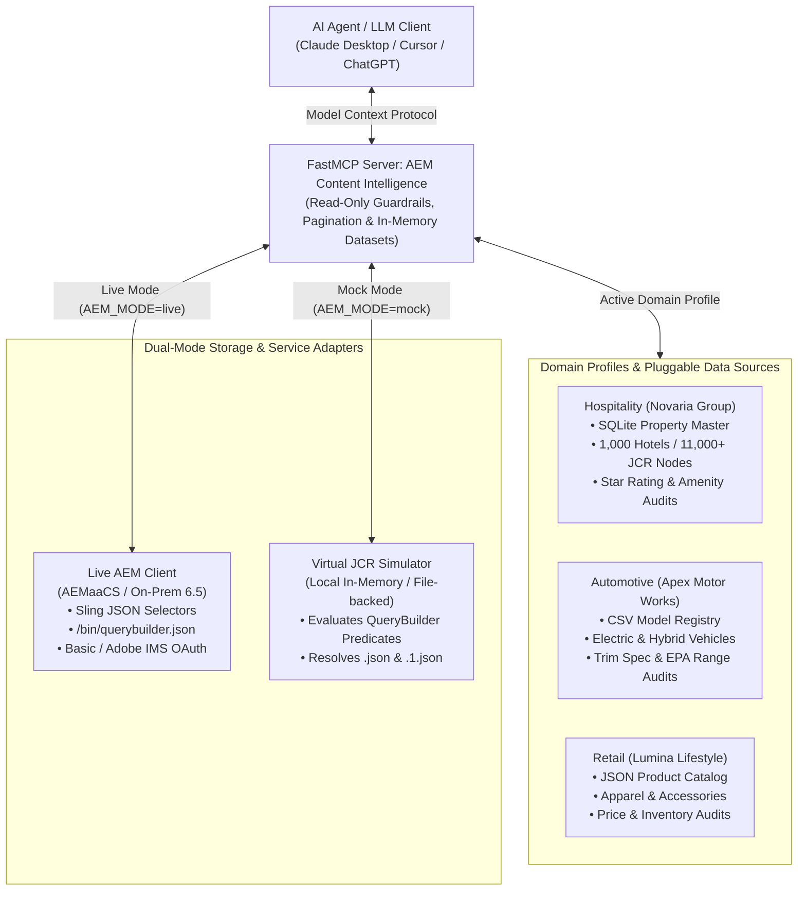

# AEM MCP Starter Kit 🚀

> **The Open-Source Model Context Protocol (MCP) Server for Adobe Experience Manager (AEM Sites, Content Fragments & DAM Assets).**  
> *Demonstrating Agentic RAG over Native Structured Systems vs. Brittle Vector Databases.*

[](LICENSE)
[](https://www.python.org/downloads/)
[](https://github.com/fabidi/aem-mcp-starter-kit/actions/workflows/ci.yml)
[](https://gofastmcp.com/)

---

## Why AEM MCP?

Most enterprise generative AI tutorials force-fit unstructured vector databases (Pinecone, Chroma, embeddings) onto structured CMS content. In Adobe Experience Manager (AEM), where content is already structured hierarchically (JCR), typed (`cq:Page`, Content Fragment Models), and indexed via QueryBuilder, **vector search is often an anti-pattern**:
- Vectors cannot evaluate template rules or resource types (`sling:resourceType`).
- Vectors cannot detect missing language copies or broken asset paths.
- Vectors cannot reconcile authored marketing claims against canonical enterprise systems of record.

By exposing AEM's native JCR content representations and QueryBuilder predicates through a thin, read-only **Model Context Protocol (MCP)** server, frontier models (Claude 3.7 Sonnet, GPT-5, Cursor, ChatGPT Work) can autonomously investigate, audit, and govern enterprise repositories with zero hallucination.



---

> [!NOTE]
> **Fictional Demo Domains Notice:**
> - **Hospitality:** **"Novaria Hospitality Group"** (`novariahotels.com`, `NVR-*`, `/content/novaria`)
> - **Automotive:** **"Apex Motor Works"** (`apexmotors.example.com`, `APX-*`, `/content/apex`)
> - **Retail:** **"Lumina Lifestyle Retail"** (`luminafashion.example.com`, `LUM-*`, `/content/lumina`)
>
> All associated brands, products, vehicle specs, and personnel are 100% fictional demo entities created strictly for testing, agentic RAG evaluation, and open-source demonstration. Any resemblance to actual companies or registered trademarks is purely coincidental.

## Key Features

1. **Pluggable Multi-Domain Architecture:**
   - Bundles ready-to-use reference domains demonstrating varied data formats: **Hospitality** (SQLite), **Automotive** (CSV), and **Retail** (JSON).
   - Easily add your own enterprise domain with a simple `domain.yaml` definition.
2. **Zero-Cost Offline JCR Simulator:**
   - Clone and run immediately on your laptop without needing an expensive Adobe Cloud license.
   - Evaluates QueryBuilder predicates, resolves Sling JSON selectors, and simulates live AEM behavior offline.
3. **Dual-System Reconciliation (AEM CMS + Master Entity Registry):**
   - Combines authored marketing content (AEM JCR) with canonical business truths (SQLite, CSV, or JSON) to pinpoint discrepancies (e.g. stale specs, pricing desyncs, missing assets).
4. **Declarative Governance Audit Engine:**
   - Define business validation rules in YAML (field comparisons, existence checks, DAM asset verification) that the MCP server evaluates deterministically across site trees.
5. **In-Memory SQLite Dataset Materialization:**
   - Instead of blowing up the LLM's context window with thousands of raw JSON nodes, the server streams query hits into local SQLite tables, performs server-side analytics, and generates downloadable **Excel (.xlsx)** and **CSV** audit workbooks.
6. **Cloud & On-Premises Ready:**
   - Seamlessly switch between Local Simulator (`AEM_MODE=mock`), On-Prem 6.5 (`AEM_MODE=onprem`), and AEM as a Cloud Service (`AEM_MODE=cloud` with Adobe IMS OAuth 2.0).

---

## 🔌 Adapting to Your Domain & External Data Sources

This MCP server is **not hardcoded to hospitality**. It uses a declarative domain profile architecture that allows you to connect **any enterprise system of record** (ERP, PIM, CRM, or Product Catalog) to audit against AEM content in 3 simple steps:

1. **Create your domain folder:** `mkdir domains/my-domain`
2. **Add your data source:** Drop your `.sqlite`, `.csv`, or `.json` file into the folder (or configure external Postgres/Snowflake connection strings).
3. **Declare `domain.yaml`:** Map your external columns to AEM JCR properties and define compliance audit rules.

```yaml
# Example: domains/automotive/domain.yaml
domain:
  name: "Apex Motor Works"
  root_path: "/content/apex"
entity:
  primary_entity: "Vehicle"
  type: "csv"
  file: "registry.csv"
mapping:
  fields:
    vin_prefix: "vinPrefix"      # ERP column <-> AEM JCR property
    base_msrp: "msrp"
audit_rules:
  - id: "msrp_desync"
    condition: "aem.msrp != registry.base_msrp"
    message: "Authored price does not match ERP manufacturing master"
```

👉 **Read the complete guide:** [**Extending Data Sources & Custom Domain Guide**](docs/EXTENDING_DATA_SOURCES.md) for detailed blueprints covering E-Commerce, Automotive, Finance/Insurance, and Healthcare.

---

## 🏛️ Composable Architecture: Starter Kit vs. Pure Enterprise AEM Mode

Because the Model Context Protocol (MCP) strictly isolates servers without an inter-server data bus, passing thousands of catalog rows between two independent MCP servers through an LLM context window causes severe token bloat and latency. This starter kit solves this via a **Composable CQRS Pattern**:

| Operational Mode | Configuration | Tools Registered | Recommended Use |
| :--- | :--- | :--- | :--- |
| **Batteries-Included Starter Kit** *(Default)* | `AEM_MCP_ENABLE_REGISTRY=true` | Pure AEM tools + Reference Registries (`registry_*`) + Multi-Domain profiles + SQLite analytics | 60-second evaluation, local testing, and multi-system reconciliation demos out of the box. |
| **Pure Enterprise AEM Mode** | `AEM_MCP_ENABLE_REGISTRY=false` | 100% Pure AEM JCR tools + Oak Index Linter + Universal Dataset Engine (`dataset_*`) | Production environments where SAP, Salesforce, Salsify, or Snowflake operate on their own dedicated enterprise MCPs. |

### Bridging External Enterprise MCPs (Zero-Token Overhead)
In enterprise setups, your **Snowflake, SAP, or Postgres MCP** simply drops an extract to disk (CSV, JSON, or JSONL). The agent then streams it directly into our analytical SQLite engine:
```python
# 1. External MCP drops data -> Ingest into SQLite WAL without touching LLM context tokens:
dataset_import(file_path="exports/sap_inventory.csv")    # -> ds_ext

# 2. Stream AEM authored pages into SQLite:
aem_query_dataset(query={"path": "/content/site"})      # -> ds_aem

# 3. Server-side join in SQLite at native C-speed (2ms):
dataset_match(left_id="ds_aem", right_id="ds_ext", left_field="sku", right_field="sku")
```
The raw rows never touch the LLM conversation history—the agent only sees clean aggregate stats and discrepancy counts!

---

## 60-Second Quickstart

### 1. Installation
Clone the repository and install with `uv` (recommended) or `pip`:

```bash
git clone https://github.com/fabidi/aem-mcp-starter-kit.git
cd aem-mcp-starter-kit

# Using uv (fastest)
uv venv
uv pip install -e ".[dev]"

# Or standard pip
python -m venv .venv
source .venv/bin/activate  # On Windows: .venv\Scripts\activate
pip install -e ".[dev]"
```

### 2. Generate Synthetic Seed Data (Mock Mode)
```bash
python tools/generate_dataset.py
```
This generates:
- `data/property_master.sqlite` (1,000 canonical hotels, 4 brand tiers, 50 global destinations)
- `data/jcr_mock_store.json` (11,000+ JCR nodes with 350 deliberate audit anomalies across 9 categories)

### 3. Run Autonomous Agent Audit Simulation
Simulate how an autonomous AI Assistant (e.g. Claude 3.7 or ChatGPT) executes an end-to-end 6-phase content intelligence audit across 11,000+ nodes, reconciles PMS records, and generates an Excel report in under 2 seconds:

```bash
python tools/simulate_agent_audit.py
```

### 4. Run the Test Suite
```bash
pytest -v
```

---

## 🎛️ Interactive MCP Instance, Role & Environment Configurator UI

Inspired by enterprise MCP gateways (such as ZohoMCP), `aem-mcp-starter-kit` includes a built-in **Web Configurator UI** and **Multi-Environment Profile Engine**. Instead of exposing all 35 tools to every agent across every environment, you can create multiple scoped MCP instances—either **from scratch (`blank`)** or **from a Role Preset**—and bind each instance to a target environment tier (`dev`, `int`, `qa`, `stg`, `prod`, or custom tiers like `uat`).

```bash
# Launch the interactive Web Configurator UI at http://127.0.0.1:8765
aem-mcp --configurator
# Or use the dedicated CLI script:
aem-mcp-configurator
```

### Key Configurator Capabilities
1. **Configurable Environment Tiers (`dev` → `prod`):**
   - Pre-seeded with **`dev`** (Local Mock Simulator), **`int`**, **`qa`**, **`stg`**, and **`prod`** (AEMaaCS / On-Prem 6.5), with support for adding custom environments (e.g., `uat`, `perf`) and configuring URLs, auth modes (`mock`, `onprem`, `cloud`), and domain profiles.
2. **Create Custom Instances From Scratch or Role Presets:**
   - **From Scratch (`blank`):** Start with `0` tools and hand-pick the exact toolset authorized for a specialized agent.
   - **AEM Developer / Oak Architect (`developer` — 24 tools on DEV..STG / 18 tools on PROD):** JCR exploration, QueryBuilder, JCR-SQL2 compiler, Oak Index Linter, CRX Package Manager sync, datasets, and Python sandbox.
   - **Content Author & QA Auditor (`content-author` — 9 tools):** JCR inspection + content integrity, cross-reference, and localization coverage audits (strictly read-only, no code execution or SQLite analytics).
   - **Data & Merchandising Analyst (`data-analyst` — 12 tools):** Bulk QueryBuilder streaming, SQLite dataset analytics, cross-system matching, and Excel/CSV export.
   - **Pure Enterprise AEM (`pure-aem` — 28 tools)** & **Full Unscoped (`full` — 35 tools)**.
3. **⚡ Batch Role × Environment Generator (`<role>-<env>`):**
   - Generate an entire promotion pipeline of MCP instances for a role in one click (e.g., `aem-dev-dev`, `aem-dev-int`, `aem-dev-qa`, `aem-dev-stg`, `aem-dev-prod`), automatically stripping mutating tools (`execute_code`, `package_create`, `package_set_filters`, `package_build`, `package_upload`, `package_install`) on `prod` instances while retaining read-only `package_list` and `package_download`.
4. **1-Click `mcpServers` Client Config Exporter:**
   - Export ready-to-paste JSON for Claude Desktop, Cursor, or Antigravity IDE scoped to a **Single Instance**, **All Environments of Current Role (`DEV..PROD`)**, or **All Configured Instances**.

```bash
# Run a specific scoped MCP instance directly via CLI:
aem-mcp --instance aem-dev-stg
aem-mcp --instance aem-author-prod

# Or print the generated mcpServers JSON directly to stdout:
aem-mcp --export-config
```

---

## 📦 Environment-Scoped CRX Package Manager & Multi-Instance Sync

When synchronizing content across AEM environments (e.g. pulling an authored page tree from **INT** or **STG** down to **Local DEV**), the architecture is strictly **environment-scoped**:
- **One MCP Process per Environment:** Each MCP process is bound to a single configured AEM environment (`aem://environment` identifies whether an instance is `dev`, `int`, `qa`, `stg`, or `prod`).
- **No Target Environment Parameter in Tools:** Package tools never accept an environment argument—the selected MCP connection determines the target environment. There is no hidden cross-environment network bridge inside a single MCP process; coordination happens through the host exposing multiple named MCP connections.
- **Zero-Token Private Exchange Storage (`package_handle`):** Package ZIP bytes are stored on disk in MCP-managed private exchange storage (`packages/exchange/`) and represented to the agent exclusively by an opaque handle (`pkg_<12hex>`). Raw ZIP bytes are **never** sent through the conversation or loaded into the model context.
- **Intentional Lifecycle Separation & Confirmation Gates:** Creation, filter updates, building, upload, and installation require explicit confirmation (`confirm=True`), whereas `package_list` and `package_download` are strictly read-only. Filter validation blocks unsafe roots (`/` and `/etc/packages`).

```text
INT MCP (aem-dev-int):
  package_create -> package_set_filters -> package_build -> package_download (returns pkg_<12hex>)

Local MCP (aem-dev-local):
  package_upload(package_handle="pkg_<12hex>") -> package_install
```

---

## Connecting to AI Clients

### Antigravity IDE Configuration
Add to your Antigravity MCP configuration (`~/.gemini/antigravity/mcp_config.json`):

```json
{
  "mcpServers": {
    "aem": {
      "command": "uv",
      "args": [
        "--directory",
        "/absolute/path/to/aem-mcp-starter-kit",
        "run",
        "aem-mcp"
      ],
      "env": {
        "AEM_MODE": "mock",
        "AEM_DOMAIN": "hospitality"
      }
    }
  }
}
```

### Claude Desktop Configuration
Add the server to your `claude_desktop_config.json`:

```json
{
  "mcpServers": {
    "aem-content-intelligence": {
      "command": "uv",
      "args": [
        "--directory",
        "/absolute/path/to/aem-mcp-starter-kit",
        "run",
        "aem-mcp"
      ],
      "env": {
        "AEM_MODE": "mock",
        "AEM_DOMAIN": "hospitality"
      }
    }
  }
}
```

### Cursor / Windsurf Configuration
Add to your project's `.cursor/mcp.json`:
```json

{
  "mcpServers": {
    "aem": {
      "command": "python",
      "args": ["-m", "aem_mcp.server"],
      "cwd": "/absolute/path/to/aem-mcp-starter-kit",
      "env": {
        "AEM_MODE": "mock",
        "AEM_DOMAIN": "hospitality"
      }
    }
  }
}
```

---

### Domain Management & Discovery Tools
| Tool | Description |
| :--- | :--- |
| `domain_list()` | List all available domain profiles, their formats (SQLite, CSV, JSON), paths, and descriptions. |
| `domain_switch(domain_id)` | Dynamically switch active business domain profile and reload underlying virtual JCR store & registries. |
| `domain_get_active()` | Retrieve metadata and active audit rules of currently selected domain profile. |
| `aem_audit_domain_rules(domain_id, root_path)` | Execute domain-specific declarative audit rules (field validations, DAM checks, price/spec parity). |

### Master Entity Registry Tools
| Tool | Description |
| :--- | :--- |
| `registry_indexes()` | List available business entity tables (`properties`, `brands`, `destinations`, etc.). |
| `registry_search(index, query, city, brand, limit)` | Search canonical records with structured filters. |
| `registry_get(index, identifier)` | Lookup canonical record by primary ID (`hotel_id`, `model_id`, `product_id`). |
| `registry_query_dataset(index, query, max_records)` | Stream and materialize canonical records into an on-disk SQLite dataset table for cross-system reconciliation. |

### AEM Read-Only Tools
| Tool | Description |
| :--- | :--- |
| `aem_json(path, depth)` | Read raw JCR node hierarchy using standard Sling `.json` selectors (depth 0..3). |
| `aem_traverse(path, depth)` | Explore child nodes and descendant levels. |
| `aem_querybuilder(query)` | Execute bounded AEM QueryBuilder predicate searches with execution timing profiling. |
| `aem_find_references(path)` | Recursively discover referenced templates, models, Content Fragments, and assets. |
| `aem_discover_properties(path, focus_term, node_type)` | Discover property usage and observed values across child nodes. |
| `aem_query_dataset(query, properties)` | Materialize large QueryBuilder search results into an in-memory SQLite table. |

### Content & Discrepancy Auditing Tools
| Tool | Description |
| :--- | :--- |
| `aem_audit_content_integrity(root_path)` | Scan content trees for broken DAM hero assets, expired promo campaigns, and incomplete Content Fragments. |
| `aem_audit_cross_reference(path)` | Reconcile AEM authored properties against Canonical PMS database (star ratings, booking status, amenity desyncs, orphan pages). |
| `aem_audit_localization_coverage(base_locale, target_locales)` | Measure regional translation parity and pinpoint missing localized pages across target locales (e.g. `fr/fr`, `de/de`, `jp/ja`). |
| `aem_compile_querybuilder_sql2(query)` | Compile QueryBuilder predicates into Oak-optimized JCR-SQL2 for index tuning and developer analysis. |
| `aem_lint_query_indexing(query, simulate_cost)` | Detect unindexed Oak traversals, evaluate 10,000-node scan abort risk, and generate remediation `/oak:index` definitions. |

### Dataset Analysis & Export Tools
| Tool | Description |
| :--- | :--- |
| `dataset_import(file_path, format, name)` | Ingest external CSV, JSON, or JSONL files into on-disk SQLite dataset table for zero-token cross-system reconciliation. |
| `dataset_info(dataset_id)` | View row counts and metadata of a materialized query dataset. |
| `dataset_get_rows(dataset_id, offset, limit)` | Read a bounded slice of rows. |
| `dataset_analyze(dataset_id, operation, field)` | Perform server-side `group_by`, `count`, `missing`, or `filter` aggregations. |
| `dataset_match(left_id, right_id, left_field, right_field)` | Cross-system reconciliation between AEM content and Master Entity Registry. |
| `dataset_export(dataset_id, format)` | Generate a downloadable CSV or standalone Excel (`.xlsx`) audit workbook. |
| `dataset_discard(dataset_id)` | Clean up temporary dataset tables. |

### CRX Package Manager & Environment Sync Tools
| Tool | Description |
| :--- | :--- |
| `package_list(group)` | **Read-only:** List CRX packages in the active MCP instance's AEM environment. |
| `package_create(name, group, version, filters, confirm)` | Create a CRX package definition via `/crx/packmgr/service/.json/...?cmd=create` and optionally set filters via `update.jsp` (`confirm=True` required). |
| `package_set_filters(name, filters, group, version, confirm)` | Replace repository filter roots as JSON via `/crx/packmgr/update.jsp`; blocks `/` and `/etc/packages` (`confirm=True` required). |
| `package_build(name, group, version, confirm)` | Assemble/build a CRX package in the active environment (`confirm=True` required). |
| `package_download(name, group, version)` | **Read-only:** Stage built package bytes into private exchange storage and return an opaque `package_handle` (`pkg_<12hex>`) without loading bytes into LLM context. |
| `package_upload(package_handle, force, confirm)` | Upload a staged `package_handle` from private exchange storage into the active environment (`confirm=True` required). |
| `package_install(name, group, version, confirm)` | Install an uploaded or built package into the active environment's repository (`confirm=True` required). |

---

## Sample Agent Prompts to Try

Once connected to Claude or ChatGPT:

1. **Content Discovery:**
   > *"Find all luxury hotels in Europe under `/content/novaria` and show me their template and Content Fragment references."*

2. **Cross-System Audit:**
   > *"Audit our European property pages against the Master Entity Registry. Are there any discrepancies between the authored star ratings on AEM pages and the canonical Property Master?"*

3. **Campaign Expiration Check:**
   > *"Search across all hotel detail pages for any promotional Experience Fragment references that link to expired 2024 campaigns."*

4. **Spreadsheet Report Generation:**
   > *"Query all properties in the system, extract their hotel ID, authored rating, and city, and export the findings as an Excel (.xlsx) file."*

---

## License
MIT License. Created by Faisal Abidi.
